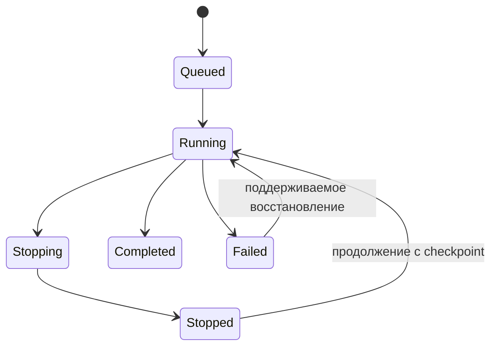

# ESPBS / EnergoStor Importer — UX Flow

Дата: 13 октября 2026 года. Статус: описание для продолжения разработки; перечисленные экраны и функции ещё не реализованы.

## 1. Контекст и границы работы

ESPBS — имя репозитория и текущей страницы. В исходном задании продукт называется EnergoStor Importer 2.0. Окончательное название приложения нужно согласовать при разработке интерфейса.

Пользователь хочет удобное Windows desktop-приложение для управления готовым парсером: запуск заданий, состояние обработки, количество записей, качество данных, передача на сервер и встроенный журнал. Тёмный зелёный стиль текущей страницы принят как возможная визуальная основа.

Парсер уже существует. По сообщению пользователя, он размещён на Selectel; код пользователь добавит в этот репозиторий из дома. SSH-вход с рабочего компьютера был отклонён с `Permission denied (publickey)`. Код, зависимости, способ запуска, схема БД и фактическая работа процесса не проверены. Адрес сервера и параметры доступа в публичную документацию не включаем.

До изучения существующего кода не создавать новый парсер, адаптеры производителей или альтернативную базу. Не заменять рабочую реализацию заглушками. Приложенный MASTER PROMPT — целевые требования к системе, а не свидетельство уже реализованных функций.

В репозитории сейчас есть статичная страница и workflow GitHub Pages. Исполняемого desktop-приложения, управляющего API и интеграции с парсером пока нет.

## 2. Предлагаемая схема работы

Основной вариант для дальнейшего обсуждения: парсер выполняется на Selectel, desktop служит пультом управления. Пользователь подтвердил расположение парсера, но окончательный выбор между серверным и домашним выполнением ещё не сделан.

Наличие перечисленных серверных компонентов нужно установить по коду. Хранилище парсера и целевой каталог могут находиться на одном сервере. Если парсер уже пишет непосредственно в итоговый каталог, отдельную синхронизацию без необходимости не добавляем.

При серверном выполнении закрытие desktop и выключение домашнего компьютера не должны останавливать задание. После подключения приложение восстанавливает актуальное состояние с сервера.

Если будет выбран домашний запуск, сохраняем те же экраны и команды, а управление направляем локальному рабочему процессу. Тогда нужны работа в трее, автозапуск и восстановление после сна или перезагрузки. Сон компьютера останавливает локальную обработку.

Предложение по оболочке: Python + PySide6, локально поставляемый HTML/CSS/TypeScript-интерфейс в Qt WebEngine. Это позволяет использовать стиль нынешней страницы. Связь интерфейса с Python — через ограниченный набор команд; удалённые страницы производителей не получают доступ к этому мосту. Конкретный стек утверждаем после изучения парсера и проверки сборки под Windows.

## 3. Каркас интерфейса

Слева — навигация: Обзор, Источники, Парсер, Каталог, Нормализация, Качество, Синхронизация, Запуски, Настройки.

Сверху — выбранное окружение, доступность сервера, время последнего обновления и активное задание. Снизу — раскрываемая консоль. В основной области — данные выбранного раздела.

Сохраняем тёмный фон, спокойные зелёные акценты, типографику и карточки существующей страницы. Главный экран отдаём рабочим показателям и действиям. Для ошибок и предупреждений используем текст, значок и цвет вместе. Таблицы поддерживают клавиатуру, фильтры и постраничную загрузку.

## 4. Первый вход и подключение

1. Пользователь открывает приложение и выбирает или создаёт профиль подключения.
2. Указывает адрес управляющего API и способ авторизации. Секрет хранится средствами ОС, не в репозитории и не в логах.
3. Нажимает «Проверить подключение».
4. Приложение проверяет доступность, авторизацию, совместимость протокола и разрешённые функции.
5. При успехе загружает источники, активные задания и сводку каталога.

Ошибки различаем: сервер недоступен, истёк доступ, недостаточно прав, несовместимая версия. Рядом показываем действие для исправления. SSH-доступ администратора не заменяет пользовательский управляющий API.

При отсутствии подключения показываем время последнего получения данных и явный статус «Данные не обновляются». Нулевые показатели не подставляем вместо неизвестных. После переподключения сначала получаем снимок состояния, затем продолжаем поток событий.

## 5. Обзор

Панель должна отвечать на вопросы: что сейчас выполняется, пополняется ли каталог, есть ли проблемы и дошли ли результаты до целевой системы.

| Блок | Содержание | Переход |
| --- | --- | --- |
| Активный запуск | Источник, этап, длительность, скорость, последний результат | Карточка запуска |
| Каталог | Уникальные товары, бренды, источники, изменение за выбранный период | Каталог с фильтром |
| Качество | READY, READY_WITH_WARNINGS, REVIEW, BLOCKED | Очередь соответствующего статуса |
| Доставка | В очереди, подтверждено, отклонено, последняя успешная отправка | Синхронизация |
| Ошибки | Количество затронутых записей и групп ошибок | Журнал с фильтром |

Показатели текущего запуска и всего каталога имеют отдельные подписи. Динамика строится по сохранённой истории; до накопления истории показываем пустое состояние.

## 6. Источники и подготовка запуска

Карточка источника: производитель, тип (API/XML/XLSX/CSV/HTML), приоритет, дата последней проверки, результат проверки, последний запуск и доступные возможности адаптера.

Начальный перечень из исходного задания: Eltex, IEK, КЭАЗ, ДКС, TRASSIR, Systeme Electric, Штиль, QTECH, NIKOMAX, PERCo, Световые Технологии, Аквариус, DEPO. Это желаемый охват. Реально работающими отмечаем только проверенные адаптеры из существующего кода.

Проверка подключения подтверждает доступность конкретного источника, но сама по себе не подтверждает корректность полного импорта.

Путь запуска:

1. «Новый запуск» → производитель и источник.
2. Выбор поддерживаемого режима: полный сбор, обновление или продолжение.
3. Настройки: лимит записей, область каталога, параметры запросов в пределах возможностей парсера.
4. Краткая сводка: что запускается, где выполняется и куда сохраняется результат.
5. «Запустить» → сервер возвращает идентификатор задания → открывается карточка запуска.

Повторный клик или потеря ответа не должны создавать два задания: команда имеет идентификатор, по которому можно проверить результат. Если источник уже обрабатывается, показываем существующий запуск и допустимые действия.

## 7. Работающий парсер

В карточке запуска показываем источник, место выполнения, текущий этап, текущий товар или страницу, время старта, длительность, скорость и последнее событие. Длинные названия и URL можно раскрыть или скопировать.

| Счётчик | Значение |
| --- | --- |
| Прочитано | Получены исходные записи |
| Сохранено исходных | Исходные записи подтверждённо записаны в хранилище |
| Добавлено | Созданы новые товары каталога |
| Обновлено | Изменены существующие товары |
| Без изменений | Повторно полученные данные не изменили запись |
| Отклонено | Запись не прошла обязательную обработку |
| Требуют проверки | Товары с замечаниями QA |

Счётчики этапов могут пересекаться. Их нельзя автоматически складывать в «всего товаров». Повторные сетевые попытки считаются отдельно от проблемных записей.

Процент показываем только при известном объёме, с указанием единицы: страницы, записи или файлы. Иначе показываем число обработанных объектов и скорость. Оценку оставшегося времени скрываем, если для неё недостаточно данных.

### Состояния задания

В интерфейсе: «В очереди», «Выполняется», «Останавливается», «Остановлен», «Завершён», «Ошибка». Завершение может сопровождаться замечаниями и отклонёнными записями.

Состояние подключения отображается отдельно. Потеря связи с desktop не означает остановку серверного задания. Живой процесс, последнее событие и последний успешно обработанный объект — разные показатели. Долгое отсутствие результата сопровождаем причиной, если она известна: ожидание ответа, ограничение частоты, повторная попытка. При отсутствии данных пишем «Состояние требует проверки».

### Остановка и продолжение

«Остановить» запрашивает завершение текущей безопасной операции и сохранение позиции. До подтверждения показываем «Останавливается». Принудительное завершение — отдельное действие с объяснением, какая незавершённая работа может быть потеряна.

«Продолжить» доступно при наличии пригодного checkpoint и поддержки со стороны парсера. Если функции нет, рядом с недоступной кнопкой объясняем причину. Повторный запуск с начала обозначаем именно как повторный запуск.

После завершения открываем итог: добавлено, обновлено, отклонено, качество, состояние доставки. Доступны переходы к товарам этого запуска, ошибкам и журналу.

## 8. Каталог и карточка товара

Поиск по названию, бренду и MPN; фильтры по источнику, категории, запуску, качеству и дате обновления. Серверная постраничная загрузка и сортировка; весь каталог в память интерфейса не загружаем.

Карточка содержит исходное и нормализованное название, бренд, MPN и алиасы, категорию, характеристики, документы, изображения, источники, историю изменений и замечания QA.

Для спорного значения доступны исходное значение, источник и правило преобразования. Ручное исправление сохраняется с историей и не должно незаметно перезаписываться следующим импортом. Конкретную политику ручных правок согласуем со схемой данных.

## 9. Нормализация, дубли и качество

В исходном задании предусмотрены преобразование единиц, словари атрибутов и брендов, происхождение каждого поля и приоритет официальных источников. Наличие этих механизмов проверяем в существующем коде.

Автоматическое объединение допускается по нормализованному бренду и точному нормализованному MPN либо подтверждённому алиасу. Одинаковые MPN разных брендов не объединяются. Нечёткие совпадения формируют кандидатов на ручную проверку.

Путь проверки: список проблем → сравнение исходных данных и источников → исправление или подтверждение → повторная QA-проверка → новый статус. Сомнительные записи QA самостоятельно не удаляет.

| Статус | Представление |
| --- | --- |
| READY | Выполнены обязательные проверки |
| READY_WITH_WARNINGS | Обязательные проверки пройдены, есть замечания |
| REVIEW | Требуется решение оператора |
| BLOCKED | Есть препятствие для дальнейшей публикации |

Оценку 0–100 сопровождаем списком причин и версией правил. Полнота не доказывает достоверность. Отдельно показываем отсутствие полей, конфликты источников, подозрительные размеры и массу, мусорный HTML, документы и происхождение данных.

Запрет импорта изображений Olnisa из исходного задания сохраняется. В UI показываем причину отклонения; проверка должна действовать и при получении, и при сохранении данных.

## 10. Синхронизация с целевым сервером

Если она нужна по фактической архитектуре, экран показывает место назначения, доступность, размер очереди, последнюю успешную передачу и ошибки отдельных записей.

Путь записи: сохранена → поставлена в очередь → отправляется → подтверждена сервером. Отдельные состояния: ожидание повторной попытки и отклонение данных сервером.

Отправленный HTTP-запрос не равен принятой записи. Подтверждение должно отражать результат сохранения в целевой системе. Пакет может иметь частичный успех: принятые записи не должны постоянно переотправляться из-за соседней ошибки.

При потере интернета сохраняем очередь. Повторная доставка использует устойчивые идентификаторы записей и версий или пакетов. Это предотвращает дубли при потере ответа. Ошибки авторизации, сети и валидации показываем отдельно.

Разрешение на отправку READY_WITH_WARNINGS, REVIEW и BLOCKED определяется политикой назначения. Хранение проблемной записи в центральном каталоге и публикация товара в OpenCart — отдельные действия. OpenCart остаётся дальнейшим этапом.

## 11. Встроенная консоль и история

Нижняя панель показывает журнал выбранного запуска: время, источник, уровень, событие и сообщение. Есть фильтры, поиск, пауза прокрутки, копирование и выгрузка диагностического журнала. Пауза прокрутки не останавливает парсер.

Логи хранятся с ротацией, UI получает ограниченные порции. Секреты, заголовки авторизации и чувствительные параметры URL маскируются до записи и отправки в интерфейс.

На первом этапе консоль поддерживает команды приложения: запуск, остановка, продолжение, повтор ошибок, синхронизация. Каждая команда проходит через тот же механизм, что и кнопки. Произвольная удалённая root-shell не входит в этот UX; потребность в полноценном терминале обсуждается отдельно.

История запусков содержит параметры, исполнителя, время, результат, статистику и checkpoint. Повтор создаёт новый запуск со ссылкой на предыдущий; восстановление сохраняет связь с исходным заданием.

## 12. Что нужно от интеграционного слоя

Интерфейсу нужны следующие возможности. Названия методов и протокол пока не зафиксированы.

- Получить возможности парсера и список источников.
- Создать задание, узнать результат команды, запросить остановку и поддерживаемое продолжение.
- Получить актуальный снимок задания и события после заданной позиции.
- Получить товары, замечания QA и логи с фильтрами и пагинацией.
- Получить состояние доставки и повторить допустимые неудачные операции.

Событие содержит идентификатор, идентификатор запуска, серверное время, тип и полезные данные. Повторное получение события не увеличивает счётчики второй раз. При разрыве истории приложение запрашивает новый снимок. Для доставки событий можно выбрать SSE, WebSocket или опрос после оценки существующего сервера.

Если парсер пока выводит только текст в stdout, сначала подключаем реальные логи и состояние процесса. Недоступные метрики отмечаем как недоступные. Для точных счётчиков добавляем события в существующий код или его обёртку.

## 13. Настройки и поведение при сбоях

Настройки: профили подключения, расписания, лимиты источников, таймауты, хранение журналов, резервное копирование, параметры доставки. Пути явно помечаются как серверные или локальные.

| Ситуация | Ожидаемое поведение |
| --- | --- |
| Desktop потерял связь | Видно время последнего обновления; состояние выполнения уточняется после подключения |
| Закрыли desktop при серверном запуске | Задание продолжает работать; при открытии восстанавливается карточка |
| Источник вернул 429 | Видны ограничение и время следующей попытки, если парсер их сообщает |
| Парсер завершился с ошибкой | Сохранены последние события; доступны диагностика и поддерживаемое восстановление |
| Закончилось место | Явная ошибка сохранения; данные не считаются успешно обработанными |
| Сервер назначения недоступен | Очередь сохраняется; доставка возобновляется после восстановления |
| Объём очереди достиг лимита | Показаны причина и политика ограничения сбора; память и диск не расходуются бесконтрольно |
| Функция не поддерживается | Кнопка недоступна, рядом объяснение |

## 14. Как продолжить из дома

1. Добавить существующий код парсера без секретов, рабочих БД, выгрузок и серверных конфигураций доступа. Репозиторий публичный.
2. Указать точную команду запуска, зависимости, место хранения результатов и способ запуска на Selectel: вручную, systemd, контейнер или другое.
3. Проверить структуру кода, поддержку STOP/RESUME, checkpoints, нормализации, QA и повторного импорта. Зафиксировать факты и пробелы.
4. Выбрать место выполнения: Selectel или домашний компьютер. Уточнить назначение сервера данных и наличие API.
5. Перед расширением репозитория ограничить GitHub Pages отдельной папкой статического фронта. Сейчас workflow загружает весь корень; Python-код и рабочие материалы не должны попадать в артефакт сайта.
6. Подключить один существующий источник: запуск из приложения → реальные события → результаты → итог запуска.
7. Проверить потерю связи, повторную команду, ошибку процесса и поддерживаемую остановку. Проверять настоящие возможности; демонстрационные данные маркировать.
8. Затем добавить каталог, QA, подтверждаемую доставку и расписания в зависимости от уже имеющихся функций.

Первый этап принимаем, когда приложение управляет реальным заданием, показывает фактические результаты, сохраняет понятную историю и корректно восстанавливает состояние после повторного подключения. Остальные разделы не объявляем работающими до их подключения.

Этот документ описывает согласованное направление и предложения по UX. Он не даёт задания заново писать парсер и не подтверждает доступность перечисленных источников.
